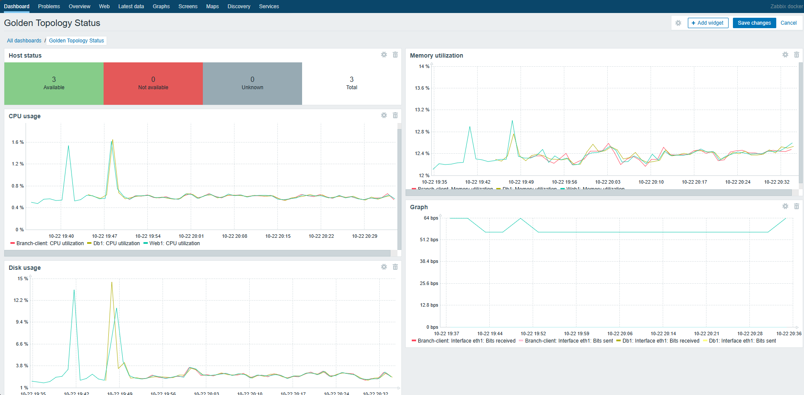
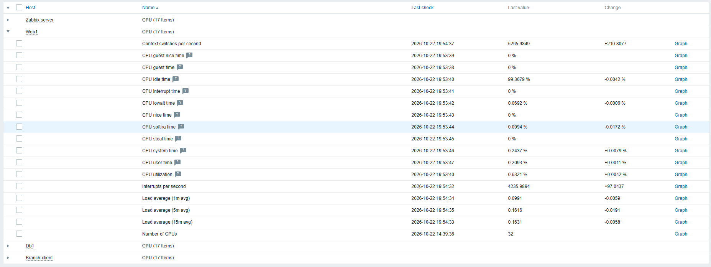
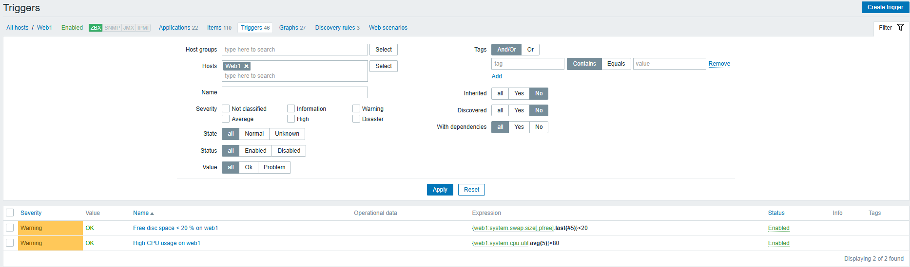
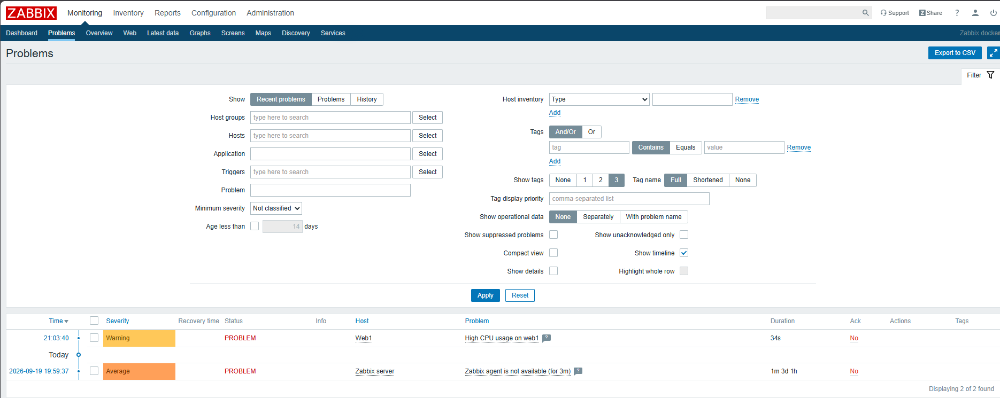

# Viikko 6 – Zabbix ja keskitetty verkonvalvonta

## 1. Johdanto

Zabbix on avoimeen lähdekoodiin perustuva, keskitetty valvontajärjestelmä. Sillä voidaan seurata palvelimien, verkkolaitteiden ja palveluiden tilaa ja toimintaa. Se kerää dataa, tallentaa historiatietoja sekä mahdollistaa hälytysten luonnin.

### Zabbixin käyttöliittymä

| Osa | Kuvaus |
|---|---|
| Hosts | Valvottavat kohteet, niiden lisäykset  |
| Templates | Valmiita templateja erilaisille mittareille ja hälytyksille|
| Monitoring | Datan seuranta |
| Dashboards | Eri dashboardien näkymät |
| Alerts | Zabbixissa hälytykset tehdään triggerien ja notifikaatoiden avulla. |
| Reports | Raporttien selaus |

## 2. Hostien lisääminen

### Web1

Aloitin asentamalla web1-konttiin zabbix-agentin. Kontista puuttui oikeat repot joten hain wgetillä paketin ja asensin sen.

```bash
wget https://repo.zabbix.com/zabbix/7.0/ubuntu/pool/main/z/zabbix-release/zabbix-release_latest_7.0+ubuntu24.04_all.deb
dpkg -i zabbix-release_latest_7.0+ubuntu24.04_all.deb
apt update
apt install -y zabbix-agent
```

Seuraavaksi muokkasin zabbix-agentin conf-tiedostosta (/ets/zabbix/zabbix_agentd.conf) seuraavat kohdat

```text
Server=172.20.20.9
ServerActive=172.20.20.9
Hostname=web1
```

Jossa käytin zabbix-serverin ip-osoitetta. Sitten starttasin sen komennolla

```bash
service zabbix-agent start
```

Zabbixista lisäsin kontin valvottavaksi kohteeksi Configuration/host ja sen alta create host

- Hostname: `web1`
- IP-osoite: 172.20.20.16
- Host Group: Linux servers
- Template: Template OS Linux by Zabbix agent

Zabbix-agentti asentui ongelmitta ja lähti tuottamaan dataa serverille kun sen conffauksen jälkeen oli startannut.

### Db1

Db1 - kontin zabbixin asennus onnistui samalla tavalla kuin web1 - kontinkin ja ongelmia ei ollut vaan kontilta lähti heti dataa virtaamaan zabbix-serverin suuntaan.

- Hostname: `db1`
- IP-osoite: 172.20.20.8
- Host Group: Linux servers
- Template: Template OS Linux by Zabbix agent


### Branch-client

Kuten aikaisemmatkin kontit, branch-client lähti tuottamaan dataa zabbix-serverille heti kun asennukset ja conffaukset oli tehty.

- Hostname: `branch-client`
- IP-osoite: 172.20.20.12
- Host Group: Workstations
- Template: Template OS Linux by Zabbix agent

**Yhteenveto hostien toiminnasta:**

Alun ongelmien jälkeen kun oli löytänyt tavan asentaa zabbix-agentit kontteihin, ongelmia ei ollut. Kaikki lähti toimimaan heti agentin starttauksen ja zabbix-serverille lisäyksen jälkeen ongelmitta.

## 3. Dashboard

### Golden Topology Status

Tein ohjeiden mukaan dashboardin nimeltä `Golden Topology Status`. Siihen lisäsin seuraavat tiedot:

Dashboard sisältää seuraavat valvontakohteet:

- CPU-kuormitus
- Muistinkäyttö
- Levytilan käyttö
- Verkkoliikenne
- Hostien tila

**Havainnot:**

Dashboardin luominen oli suoraviivaista. Ainoastaan network trafficin kanssa oli ongelmia kun aluksi item listalta ei löytynyt suoraan verkkoliikenteeseen olevia streamejä mutta ensin kirjoittamalla *bits* sain listalle ilmestymään sopivat kohteet. Niistä valitsin eth1 bits received ja eth1 sent (eth1 siksi kun eth0 on valvontaverkko).



## 4. Mittarit

**Mittareiden toiminta:**

| Mittari | Nimi | Arvo | Mitä? | Miksi? |
|---|---|---|---|---|
| CPU | CPU utilization | 0.5838% | CPUn kuormitus | Näkee suoraan CPUn kuormituksen prosentteina | 
| Memory | Memory utilization | 12.5427 % | Muistin kulutus | Näkee suoraan käytetyn muistin prosentteina |
| Uptime | System uptime | 06:50:13 | Kontin uptime | Kauan konttin on ollut päällä |
| Network Traffic  | Bits received | 56 bps | Paljon interfaceen tulee liikennettä | Nähdään onko liikennettä liikaa sisäänpäin |
| Network Traffic | Bits sent | 0 bps | Paljon interfacesta lähtee liikennettä | Nähdään onko liikennettä liikaa ulospäin |
| Disc | Space utilization | 1.2858 % | Paljon levytilaa on käytetty | Voidaan tehdä triggeri kun levytila alkaa täyttymään esim 75% |



## 5. Triggerit

### Triggerien määrittäminen

Tein kaksi triggeriä

**Triggeri 1 – CPU-kuormitus**

- Nimi: High CPU usage on web1
- Ehto: CPU > 80 %
- Vakavuusluokka: Warning
- Valvottava host: web1

**Triggeri 2 – Levytila**

- Nimi: Free disc space < 20 % on web1
- Ehto: Vapaa levytila < 20 %
- Vakavuusluokka: Warning
- Valvottava host: web1



**Havainnot:**

Triggereiden luonti oli hyvinkin yksinkertaista kun sai ensimmäisen tehtyä ja aina voi käyttää valmiita template triggereitä mitä Zabbixissa tulee valmiina.

## 6. Hälytys- ja häiriötestit

### Hälytyksen simulointi

**Testimenetelmä:**

CPUn kuormitus-testiä varten lyhensin hälytysaikaa 5m -> 1m että saan nopeammin hälytyksen aikaiseksi sekä kuormituksen rajaksi 3% koska alla oleva komento aiheutti vain 4% kuormituksen.

**Käytetty komento:**

```bash
yes > /dev/null
```

**Tulokset:**

- Syntyikö hälytys: Kyllä
- Hälytyksen ilmestymiseen kulunut aika: Ongelma oli kun sivu ei päivittynyt tarpeeksi nopeasti mutta hälytys tuli arviolta n. 30s jälkeen kun 1m raja tuli täyteen.
- Palautuiko hälytys normaalitilaan: Palautui, ja tuli RESOLVED tilaksi

**Havainnot:**

Isoin ongelma oli selaimen päivitysnopeus joka ei kuvaa täysin järjestelmän toimintaa. Jos siihen triggerin perässä olisi joku muu hälytys kuin selaimen warning-lätkä, esimerkiksi tekstiviesti tms. niin se tulisi nopeammin.



### Häiriötilanne

**Pysäytetty palvelu:**

Tätä varten lisäsin web1:sen templaten 'Template App Apache by HTTP' jonka avulla sain valmiin triggerin ja sillä myös tuli Apache2:selle service ping - tila, jonka avulla voi valvoa onko palvelu pystyssä vai ei.

**Käytetty komento:**

```bash
service apache2 stop
```

**Tulokset:**

- Havaitsiko Zabbix häiriön: Kyllä havaitsi
- Reagointiaika: n. 30s (tässä myös sivun päivittymisen viive)
- Palvelun palautuminen: Apache2:sen starttauksesta n. 30s

**Havainnot:**

Kaikki toimi kuten kuuluukin. Ongelmia en havainnut ja asennukset sujuivat todella helposti.

## 7. Työkalujen vertailu

### SNMP, Prometheus ja Zabbix

| Ominaisuus | SNMP | Prometheus | Zabbix |
|---|---|---|---|
| Tiedonkeruu | Kyselyt ja ilmoitukset | Kaapii rajapinnoista | Useita vaihtoehtoja |
| Dashboardit | Ei | Käytetään usein Grafanaa | Sisäänrakennetut dashboardit ja kuvaajat |
| Hälytykset | Ilmoitukset, muuten vaatii erillisen järjestelmän | Säännöt ja Alert manager | Sisäänrakennetut triggerit ja ilmoitukset |
| Käyttöönotto | Usein tuettu, vaatii erillisen valvonnan | Palvelimien ja kohteiden asennus/määrittely | Palvelimien ja kohteiden asennus/määrittely |
| Skaalautuvuus | Hyvä mutta vaatii oikeanlaisen ympäristön  | Hyvä, erityisesti pilvi- ja konttiympäristössä | Hyvä, tukee laajoja ympäristöjä |
| Yrityskäyttö | Yleinen | Yleinen pilvi- ja sovellusvalvonnassa | Yleinen palvelin- ja verkonvalvonnassa |

**Vertailun yhteenveto:**

Taisin aikaisemmissa palautuksissakin mainita että tässä vertaillaan kolmea täysin eri järjestelmää joille on omat vahvuutensa. Nyt kuitenkin selvinnyt että esimerkiksi zabbixilla voidaan suoraan valvoa SNMPn rajapintoja ja myös Prometheus+Grafanaan saa SNMP exporterin. Eli myös tällä tavalla voidaan jatkaa vanhojen, pelkästään SNMP:tä tukevien laitteiden valvontaa.

## 8. Pohdinta ja yhteenveto

### Pohdinta

**1. Mitä hyötyä keskitetystä valvonnasta on?**

Kuten aikasemmissa palautuksissa olen maininnut niin olen tottunut siihen että trendipiirtojen ja ns. triggereiden hälytyksien avulla pyöritän laitosta niin minun on vaikea perustella että miksi se on hyödyllistä koska se on minulle itsestään selvyys. Jo se että sie voit oikein määritellyllä dashboardilla vilkaista että kaikki on järjestelmässä kunnossa, kaikki tarvittavat on pystyssä ja kaikki on hälytysrajojen paremmalla puolella auttaa työskentelmään tehokkaasti eikä tarvitse aikaa tuhlata jokaisen kohteen/laitteen yksittäin läpikäymiseen.

**2. Mitkä mittarit ovat mielestäsi tärkeimpiä?**

Tämä riippuu täysin kohteesta. Joissakin kohteissa se on tietoliikenne, joissain levytila ja joissain tiettyjen palvelujen tila ja levyn rasitus.

**3. Millaisista tilanteista ylläpitäjän pitäisi saada hälytys?**

Sekin riippuu kohteesta. Joissain kohteessa se on apachen alas tippuminen, joissain levytilan vähyys jne. Myös hälytyksissä pitää olla asteita että minkälainen hälytys se on. A-, B- ja C-luokan hälytykset vähintään. A-luokan hälytykset lähtee samantien ja isolla kanavalla kun taas C-luokan hälytykset voidaan pitää ilmoitus-luonteisina hälytyksinä.

**4. Missä tilanteissa käyttäisit Prometheusta?**

Tässä vaiheessa opintoja rajaisin Prometheuksen käytön pilvi- ja sovellusvalvontaan

**5. Missä tilanteissa käyttäisit Zabbixia?**

ja Zabbixin palvelin- ja verkonvalvontaan

**6. Mitä valvontatoimintoja lisäisit tähän ympäristöön?**

sekä SNMP:tä käyttäisin verkkoympäristöissä koska se on kevyt, hyvin tuettu (etenkin vanhojen laitteiden osalta) ja voidaan käyttää mm. Prometheus+Grafana - yhdistelmää jolloin voidaan yhdistää kaikkia näitä.

### Yhteenveto

Jos vedetään kurssi yhteen pakettiin niin olen työn puolesta paljon käyttänyt keskitettyä valvontaa. En tosin it-puolella mutta laitospuolella ja samat lainalaisuudet pätee molempiin. Liika tieto on turhaa, keskitytään jokaisessa kohteessa vaan niissä tärkeimpiin jolloin, varsinkin isoissa järjestelmissä pystytään havannoimaan poikkeavuudet. Isosta massasta on vaikea erottaa poikkeavuutta.
Nykypäivänä taas tekoäly ajaa sen puolesta että voidaan ajaa isoja massoja tietoja ja se seuloo niistä poikkeavuudet valvontaan näkyville. Minusta tämä taas on erillisen kurssin asioita mutta sen verran sivuan tässä sitä että sen määrittelyt, rajojen haut ja opetus on erityisen tärkeitä sen ympäristön pystyttämisessä. Jos esimerkiksi valvoja tietää että joku isompi, sovittu ajo on tarkoitus toteuttaa tiettynä kellonaikana niin tekoälyn malli saattaisi luulla sitä vaikka hyökkäykseksi tai resurssien loppumiseksi.
Erityisesti tämä kurssi tarjosi minulle keskitetystä ylläpidosta, ehkä käytännönläheisempää näkökulmaa. Olen aina tiennyt että se toteutetaan niin mutta nyt pääsin itse sitä tekemään.
